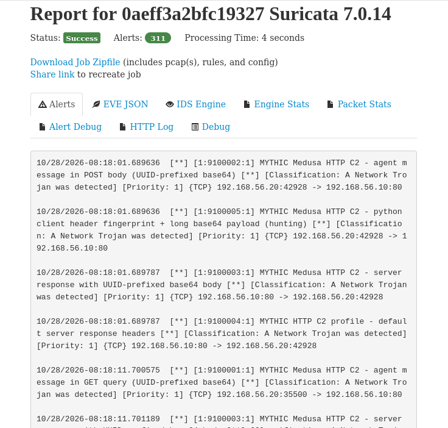
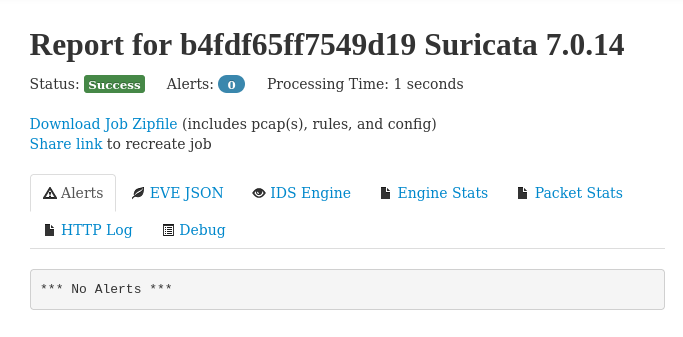

# Отчёт: обнаружение Medusa Mythic C2 (HTTP C2 Profile) сигнатурами Suricata

## Цель и результат

Цель: разработать сигнатуры Suricata для обнаружения сетевого взаимодействия агента **Medusa** с сервером **Mythic C2** через **HTTP C2 Profile**, которые покрывают активность агента в целом, а не отдельную команду или конкретную конфигурацию стенда, и при этом не дают ложных срабатываний на легитимный HTTP.

Результат:
- 5 правил в [`medusa_mythic_http.rules`](medusa_mythic_http.rules) (SID 9100001–9100005);
- на трёх записанных сессиях Medusa (102 HTTP-сессии) алерт получен на **102 из 102**, всего 311 алертов;
- на легитимном HTTP-трафике - 0 алертов.

Содержимое обмена зашифровано, поэтому команды из трафика не видны. Правила описывают **структуру протокола Mythic**, а не URI, User-Agent, адреса или команды. Эти параметры настраиваются оператором и менялись между нашими сессиями.

## Стенд и развёртывание

- Две виртуальные машины Debian в одной внутренней сети: **MythicServer** (`192.168.56.10`) и **Target** (`192.168.56.20`) с агентом Medusa.
- На MythicServer развёрнут Mythic из репозитория its-a-feature/Mythic.
- Собрано три payload, копировались на Target и запускались там:
  1. по умолчанию;
  2. изменены `get_uri`/`post_uri`, `callback_interval`/`jitter`;
  3. изменены User-Agent.
- В payload включались команды `shell`, `cd`, `download`, `upload`, `ps`, `sleep`, `exit`. В сессиях выполнялись команды из этого набора.
- Трафик записывался `tcpdump` на сервере (`-w` в отдельный файл на каждую сессию, до запуска агента), затем три файла объединены в `medusa_all.pcap`.

## Записанный трафик

Каждое соединение отдельное, поэтому одна TCP-сессия = одна HTTP-транзакция. Всего 102 TCP-сессии и 102 HTTP-транзакции.

Какая активность различима в трафике:
- **checkin** - POST, тело 584 байта (во всех трёх записях);
- **опрос задач** - GET, сообщение в параметре `q`, ответ сервера без задач 176 байт;
- **выдача задач** - ответы сервера 264–368 байт;
- **результаты команд** - POST 304–392 байта;
- **передача крупного объёма данных** - один POST около 69 КБ (запись 3.1).

Сообщения зашифрованы, поэтому по трафику нельзя определить, какая именно команда выполнялась.

## Анализ трафика и выбор признаков

Структура всех сообщений Mythic в этих записях одинакова:

```
base64( UUID (36 ASCII) | IV (16) | AES-CBC шифртекст | HMAC (32) )
```

GET передаёт сообщение в параметре запроса (URL-safe base64), POST и ответ сервера - в теле (обычный base64). UUID - идентификатор callback, он начинает каждое сообщение в обе стороны.

| Признак | Сессия 1 | Сессия 2 | Сессия 3 | Стабилен? | Риск FP | Решение |
|---|---|---|---|---|---|---|
| URI | `/data`, `/index` | `/api/v1/events`, `/static/js/analytics.js` | как в 2 | нет, задаётся конфигом | - | отброшен |
| Имя параметра (`q`) | `q` | `q` | `q` | в этих записях да, но настраивается | - | в правиле допускается любое имя |
| IP-адреса, порт | `.20 → .10:80` | то же | то же | это стенд | - | отброшены |
| Размеры запросов и ответов | различны | различны | различны | нет, зависят от команд | - | отброшены |
| Интервал опроса | ~10 с | ~40 с | ~40–50 с | нет (sleep/jitter) | - | отброшен |
| Метод GET/POST | оба | оба | оба | да | высокий | не признак, лишь определяет, где искать сообщение |
| **Сообщение начинается с base64(UUID)** | да | да | да | **да** | **очень низкий** | **основной признак** |
| Набор заголовков ответа Mythic по умолчанию | да | да | да | да, но настраивается | низкий | вошёл (средняя уверенность) |
| Порядок заголовков клиента (Python `http.client`) | да | да | да | да | средний | вошёл как hunting-правило |

Почему отброшены URI, User-Agent, интервал: они различаются между тремя нашими записями, значит, правило на них сработало бы только на одной конфигурации. Размеры и команды зависят от активности, а не от протокола.

## Сигнатуры

Файл: [`medusa_mythic_http.rules`](medusa_mythic_http.rules). Адреса `any any -> any any`, направление задаётся через `flow:` (C2 может быть и во внутренней сети).

| SID | Что обнаруживает | Уверенность |
|---|---|---|
| 9100001 | GET: значение любого параметра запроса начинается с base64(UUID) | высокая |
| 9100002 | POST: тело запроса начинается с base64(UUID) | высокая |
| 9100003 | Ответ 200: тело начинается с base64(UUID) | высокая |
| 9100004 | Ответ: заголовки Mythic HTTP profile по умолчанию (`Server: NetDNA-cache/2.2`, двойной `Content-Type`, `Pragma: no-cache`, `Cache-Control: max-age=0, no-cache`) | средняя |
| 9100005 | Отпечаток заголовков клиента Python (`Accept-Encoding: identity` первым, `Connection: close` последним) + длинный base64-параметр или POST; `threshold`: 1 алерт на источник за 300 с | низкая (hunting) |

**Почему 9100001–9100003 специфичны.** UUID - 36 символов формата `8-4-4-4-12`, только `0-9a-f` и тире на позициях 8, 13, 18, 23. 36 байт делятся на 3 без остатка, поэтому в base64 они дают ровно 48 символов (12 групп по 4) без паддинга и с фиксированным выравниванием. Для каждой из 48 позиций перебором допустимых байтов вычислено множество допустимых символов base64. Получился regex из 48 классов (около 530 знаков), вероятность случайного совпадения порядка 2⁻¹⁴³. Остальная часть сообщения проверяется только на алфавит base64 и минимальную длину; порог длины низкий и нужен лишь как предфильтр. Паддинг `=`/`%3D` в конце GET-параметра учтён. Шифрование не требуется: префикс UUID есть и в режиме без шифрования.

**Почему 9100004 - средняя уверенность.** Это заголовки дефолтного профиля, оператор может их изменить. Сам баннер `NetDNA-cache/2.2` встречался у реальных CDN, но вместе с двойным `Content-Type` (libhtp склеивает его в `application/javascript; charset=utf-8, application/octet-stream`) и `no-cache` совпадение редкое.

**Почему 9100005 - только hunting.** Порядок заголовков - следствие того, что Medusa написан на Python, но тот же отпечаток дают любые скрипты на `http.client`/`urllib`.

## Проверка и покрытие

### Трафик Medusa

Прогон `pcaps/medusa_all.pcap` в Dalton (Suricata 7.0.14): Success, 311 алертов. Сырые логи: [`logs/fast.log`](logs/fast.log), [`logs/eve.json`](logs/eve.json).



Engine Stats: `tcp.sessions = 102`, `app_layer.tx.http = 102`, `detect.alert = 311`, `detect.alerts_suppressed = 97`. Дамп прочитан целиком: 2526 пакетов.

Алерты по записям (сумма соответствует `medusa_all.pcap`):

| Запись | HTTP-сессий | с алертом | 9100001 | 9100002 | 9100003 | 9100004 | 9100005 |
|---|---|---|---|---|---|---|---|
| `medusa_session3.1.pcap` | 87 | **87** | 84 | 3 | 87 | 87 | 3 |
| `medusa_session3.2.pcap` | 5 | **5** | 2 | 3 | 5 | 5 | 1 |
| `medusa_session3.3.pcap` | 10 | **10** | 9 | 1 | 10 | 10 | 2 |
| `medusa_all.pcap` | 102 | **102** | 95 | 7 | 102 | 102 | 5 |

Правило 9100005 совпало на всех 102 запросах, но из-за `threshold` выдало 5 алертов (97 подавлено).

### Легитимный трафик

Те же правила на легитимном HTTP-трафике ([`logs/legit_traffic.pcap`](logs/legit_traffic.pcap)): Success, 0 алертов.



### Полнота покрытия

- 102 из 102 сессий дают алерт, в том числе во всех трёх конфигурациях профиля (разные URI, User-Agent, интервал).
- Запрос и ответ обнаруживаются независимо, поэтому достаточно видеть одну сторону обмена.
- Покрыты все наблюдавшиеся типы сообщений: checkin, опрос, выдача задач, результаты команд, крупная передача данных (POST около 69 КБ).

## Что может остаться необнаруженным (false negative)

- **Сообщение в Cookie или заголовке** (профиль это поддерживает): 9100001–9100003 смотрят только URI, тело запроса и тело ответа.
- **Трансформации сообщения** в профиле (префикс, другая кодировка): base64(UUID) оказывается не в начале.
- **HTTPS**: содержимое недоступно без расшифровки; нужны SNI, JA3/JA4, сертификаты.
- **Другие C2-профили и транспорты** (WebSocket, SMB, TCP, DNS) не исследовались.
- **Заголовки ответа изменены оператором**: перестаёт работать 9100004, но 9100003 остаётся.
- **Очень короткие незашифрованные ответы** (менее 90 символов base64) пропускает 9100003; запрос при этом обычно виден.
- **Повреждённый или неполный pcap** (потеря нужного направления, разбор HTTP невозможен).

## Возможные ложные срабатывания (false positive)

- **9100001–9100003.** Срабатывают только на значения, которые начинаются с base64 от UUID. Обычный длинный base64 (JWT, загрузка файла, токены, OAuth-параметры) сюда не попадает. Ложное срабатывание возможно, если приложение сознательно кодирует `UUID + данные` в base64 в самом начале параметра или тела (внутренние токены, идентификаторы сессий). Это редкий случай.
- **9100004.** Легитимный CDN на NetDNA/MaxCDN с тем же набором заголовков. Маловероятно из-за двойного `Content-Type` вместе с `Pragma` и `Cache-Control`.
- **9100005.** Любые Python-скрипты на `http.client`/`urllib` с длинным base64 в параметре или теле. Поэтому правило помечено как hunting и ограничено `threshold`.

## Ограничения

- Негативная проверка выполнена на ограниченном наборе легитимного трафика, а не на реальном корпоративном архиве; частоту FP в production по нему оценить нельзя.
- Правила не определяют команды агента и не отличают Medusa от других агентов Mythic с тем же HTTP-профилем; единственный признак клиента Medusa - слабое правило 9100005.

## Как воспроизвести

```
git clone https://github.com/artiwolf/suricata-rules.git && cd suricata-rules
suricata -T -S medusa_mythic_http.rules -c /etc/suricata/suricata.yaml     # проверка синтаксиса
mkdir -p out && suricata -r pcaps/medusa_all.pcap -S medusa_mythic_http.rules -l out -k none \
        -c /etc/suricata/suricata.yaml --set unix-command.enabled=no
grep -o '\[1:[0-9]*:1\]' out/fast.log | sort | uniq -c                     # ожидаемо: 95 / 7 / 102 / 102 / 5
```

Dalton: движок Suricata 7.0.14 -> загрузить pcap -> вставить правила на вкладке Custom Rules -> Submit.
